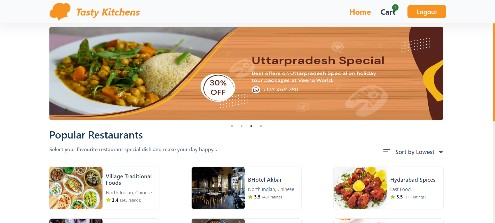
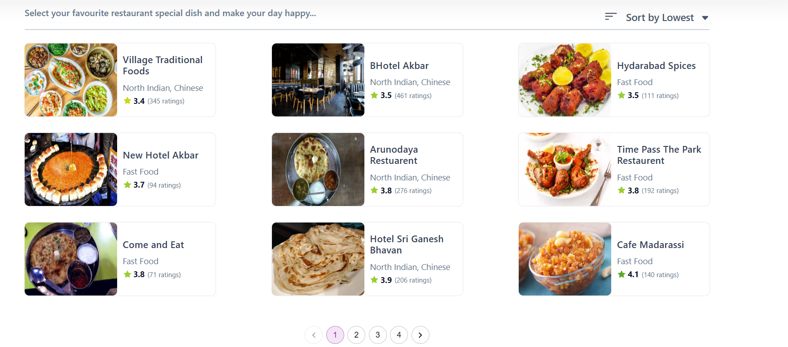
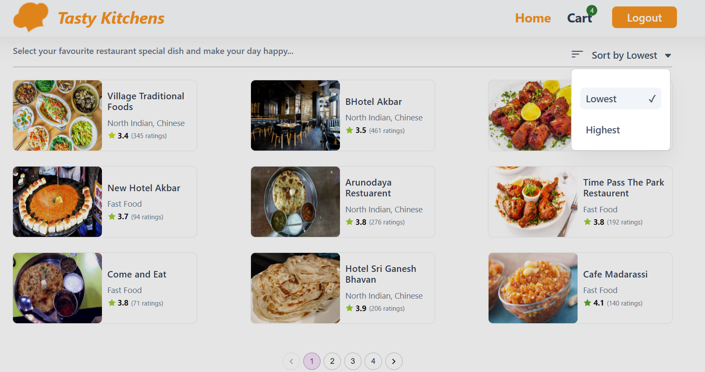
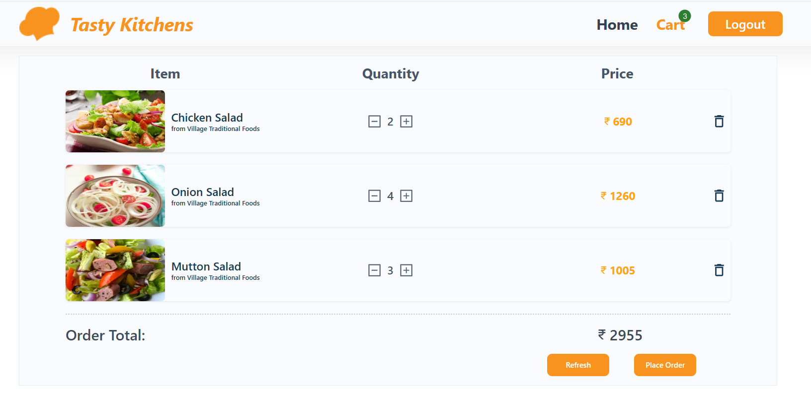

# 🍽️ Tasty Kitchens – Food Ordering Application

A React-based food ordering web application inspired by popular food delivery platforms. Users can explore restaurants, browse food menus, sort restaurants, add items to their cart and manage their orders.

**Maintained and customized by Abinayateja**

## 🚀 Live Demo

**[Visit Tasty Kitchens](https://abinayateja.github.io/TASTY-KITCHENS/)**

## 📸 Project Screenshots

### 1. Home Page

Explore promotional offers and discover popular restaurants.



### 2. Restaurant Listings

Browse restaurants with their cuisine details, ratings and pagination.



### 3. Restaurant Sorting

Sort restaurants using the available lowest and highest rating options.



### 4. Shopping Cart

Manage selected food items, update quantities, remove items and view the order total.



## ✨ Features

- User login and authentication.
- JWT-based authentication.
- Protected routes for authenticated users.
- Promotional offers carousel.
- Restaurant listing using API integration.
- Restaurant details and food menu.
- Restaurant sorting by ratings.
- Pagination for restaurant listings.
- Add food items to the shopping cart.
- Increase and decrease item quantities.
- Remove items from the cart.
- Automatic order total calculation.
- Cart state management across components.

## 🛠️ Technologies Used

| Technology | Purpose |
|---|---|
| React.js | Frontend development |
| JavaScript (ES6+) | Application logic |
| HTML5 | Page structure |
| CSS3 | Styling and responsive design |
| React Router DOM | Client-side routing |
| React Context API | Shared cart state |
| REST APIs | Fetching application data |
| Fetch API | HTTP requests |
| js-cookie | Managing authentication cookies |
| JWT | Authentication |
| Material UI | UI components |
| React Slick | Promotional carousel |
| React Icons | Icons |

## 🏗️ Application Structure

The application is organized into reusable React components.

- **Login:** Handles user authentication.
- **Home:** Displays promotional offers and restaurant listings.
- **Restaurant Details:** Displays restaurant information and food items.
- **Cart:** Manages selected food items and order totals.
- **Protected Routes:** Restricts access to authenticated pages.
- **Context API:** Shares cart information across components.

## 🔌 API Integration

The application integrates with external REST APIs for:

- User authentication.
- Promotional offers.
- Restaurant listings.
- Restaurant details and food menus.

JWT authentication is used to maintain the authenticated session through browser cookies.

**Note:** The application depends on the availability of the external API service.

## ⚙️ Installation and Setup

### 1. Clone the repository

```bash
git clone https://github.com/Abinayateja/TASTY-KITCHENS.git
```

### 2. Navigate to the project directory

```bash
cd TASTY-KITCHENS
```

### 3. Install dependencies

```bash
npm install
```

### 4. Start the development server

```bash
npm start
```

Open your browser and visit:

```text
http://localhost:3000
```

### 5. Create a production build

```bash
npm run build
```

## 👨‍💻 Author

**Abinayateja**

- GitHub: [@Abinayateja](https://github.com/Abinayateja)
- Portfolio: [My Portfolio](https://portfolio533.netlify.app/)

This repository represents my learning and customization of a React-based food ordering application. Original educational project materials and their respective authorship are acknowledged.

---

⭐ Feel free to explore the project and its implementation!
